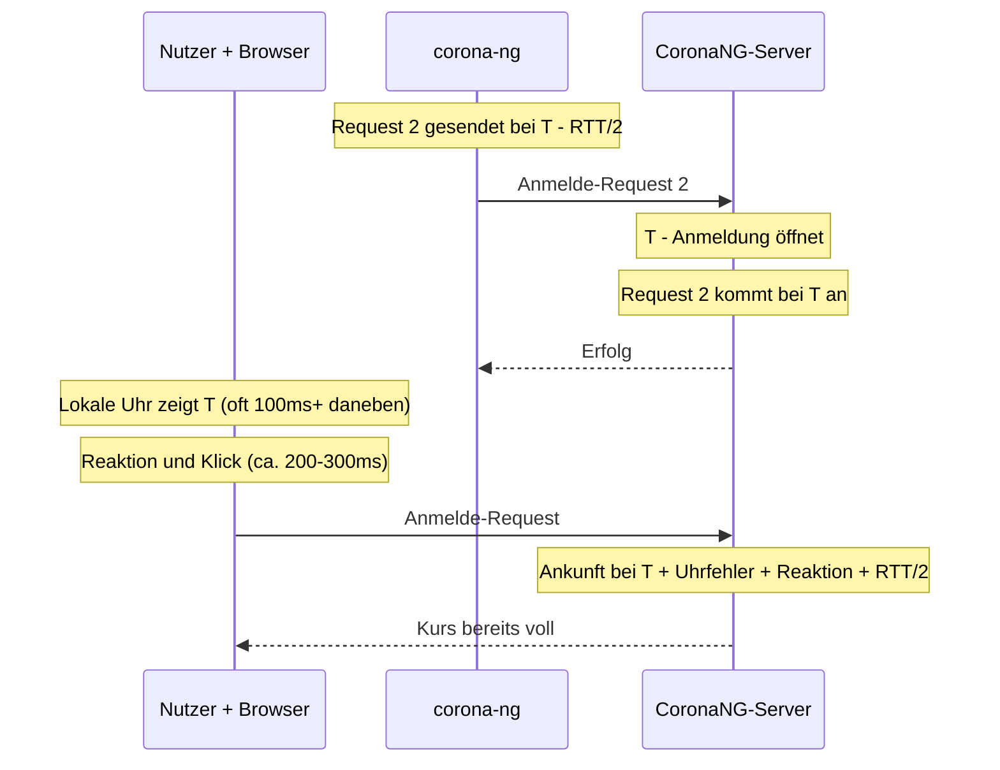
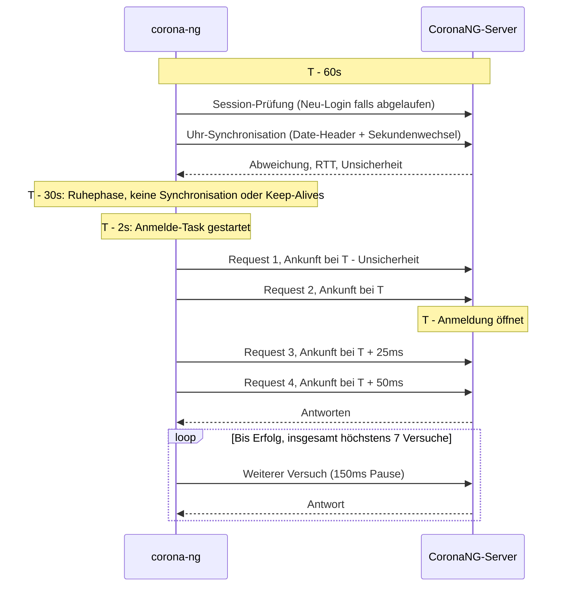

# CoronaNG - Automatisierte ASQ-Anmeldung

[](README.md)
[](README.de.md)

`corona-ng` ist ein Terminal User Interface (TUI), das Studierenden der **Universität Ulm** hilft, Plätze in **ASQ-Kursen (Additive Schlüsselqualifikationen)** über das [CoronaNG-Portal](https://campusonline.uni-ulm.de/CoronaNG/index.html) zu sichern.

## Das Problem
Die Anmeldung für ASQ-Kurse öffnet in der Regel zu einer festen Uhrzeit. Da sehr viele Studierende gleichzeitig versuchen, sich anzumelden, sind die Server der Universität oft überlastet. Mit einem normalen Webbrowser ist eine Anmeldung dann kaum möglich. Bei begrenzten Plätzen zählt jede Millisekunde.

## Die Lösung
Diese Anwendung ist in **Rust** geschrieben und arbeitet **headless** (ohne Browser). Sie spart den Overhead einer Browser-Engine und sendet HTTP-Requests direkt an das Portal. Dadurch ist sie deutlich schneller als eine manuelle Anmeldung.

### Hauptfunktionen
- **Headless & schnell:** Deutlich schneller als jeder browserbasierte Ansatz.
- **Synchronisation mit der Serveruhr:** Misst die Abweichung zwischen deiner Systemuhr und der Uhr des CoronaNG-Servers. Die Zielzeit bezieht sich so auf den Server, nicht auf deinen Rechner.
- **Timing nach Ankunftszeit:** Jeder Request wird eine halbe Round-Trip-Time früher gesendet, damit er zur geplanten Zeit beim Server *ankommt*.
- **Gestaffelter Burst:** 4 parallele Requests kommen rund um die Zielzeit an (einer um die Unsicherheit der Uhr zu früh, dann bei `+0ms`, `+25ms` und `+50ms`). Das deckt Fehler der Uhr in beide Richtungen ab, ohne den Server zu überlasten.
- **Automatische Wiederholungen:** Wenn der Burst nicht erfolgreich ist, folgen nacheinander weitere Versuche mit 150ms Pause, insgesamt bis zu 7 Versuche.
- **Robuste Session-Verwaltung:** Hält die Session aktiv, prüft sie kurz vor jeder Zielzeit und meldet sich automatisch neu an, wenn sie abgelaufen ist.
- **Modernes TUI:** Gebaut mit `ratatui`, mit einem Dashboard für beobachtete Kurse.
- **Sichere Speicherung der Zugangsdaten:** Nutzt den Schlüsselbund des Systems, um deine Uni-Zugangsdaten sicher zu speichern.
- **Live-Feedback:** Zeigt die aktuelle Uhrzeit, die Abweichung zur Serveruhr mit ihrer Unsicherheit sowie geplante Sendezeit, Sendezeit, Ankunftszeit und Antwortzeit jedes Anmeldeversuchs.

## Warum es schneller ist

Die Anmeldung bei CoronaNG öffnet nach der **Serveruhr**. Wer den Browser
nutzt, beobachtet die eigene Uhr, wartet auf die Zielzeit und klickt. Danach
sendet der Browser den Request und rendert die Antwort. Jeder Schritt kostet
Zeit:

- Die lokale Uhr weicht oft um mehrere hundert Millisekunden oder mehr ab.
- Reaktion und Klick dauern einige hundert Millisekunden.
- Der Request braucht eine halbe Round-Trip-Time (RTT) bis zum Server.
- Der Browser lädt und rendert ganze Seiten, während der Server unter Last steht.

`corona-ng` vermeidet diese Verzögerungen:

- Es misst die Abweichung der Serveruhr und plant jeden Request in Serverzeit.
- Es sendet jeden Request `RTT/2` vor seiner geplanten Ankunft.
- Es ist bereits angemeldet. Die Session wird 60s vor der Zielzeit geprüft,
  daher ist zur Zielzeit selbst kein Login nötig.
- Es sendet reine HTTP-Requests ohne Browser.
- Ab 30s vor der Zielzeit startet es keine Uhr-Synchronisation und keine
  Keep-Alives, damit kein anderer Verkehr mit den Anmelde-Requests konkurriert.

### Browser vs. corona-ng



### Ablauf einer geplanten Anmeldung



### Uhr-Synchronisation

Die Serveruhr wird nach dem Login, alle 10 Minuten und 60s vor jeder Zielzeit
synchronisiert. Eine Synchronisation läuft in zwei Schritten:

1. **Grobe Schätzung:** 8 Requests lesen die Serverzeit aus dem HTTP-Header
   `Date` (oder aus der "Serverzeit" auf der Kursseite). Die schnellere Hälfte
   wird behalten und deren Median der Abweichung verwendet.
2. **Sekundenwechsel:** Der `Date`-Header hat nur eine Auflösung von ganzen
   Sekunden. `corona-ng` fragt den Server daher kurz vor der nächsten Sekunde
   ab und erkennt den Moment, in dem die Serversekunde wechselt. Das geschieht
   3 Mal und ergibt eine Abweichung, die auf wenige zehn Millisekunden genau ist.

Das Dashboard zeigt deine Systemzeit (in deutscher Zeit) mit der gemessenen
Abweichung (z.B. `16:00:00.000 +0.120s`) und darunter die Unsicherheit (z.B.
`Server-Offset +/-15ms`). Eine positive Abweichung bedeutet, dass der Server
deiner Systemuhr voraus ist. Ist die Abweichung größer als 1s, erscheint eine
Warnung. Die Anmeldung funktioniert trotzdem, du solltest aber die
Zeitsynchronisation deines Systems prüfen.

Das Anmelde-Popup zeigt für jeden Request vier Zeiten, alle relativ zur
Zielzeit: `Planned` (geplante Sendezeit), `Sent` (Sendezeit), `Arrival`
(geschätzt als `Sent + RTT/2`) und `Response` (Antwortzeit).

## Erfolgsgeschichte
Mit diesem Tool wurde erfolgreich ein Platz in einem Kurs mit **180 Beobachtern** und nur **20 freien Plätzen** gesichert. Während die Webseite für viele nicht erreichbar war, kam `corona-ng` mit der Anmeldung in den ersten Millisekunden durch.

## Technologien
- **Sprache:** Rust
- **Async-Runtime:** `tokio`
- **Zeit:** `chrono` & `chrono-tz`
- **Netzwerk:** `reqwest` (mit Cookie-Verwaltung)
- **UI:** `ratatui` & `crossterm`
- **Sicherheit:** `keyring` (native Speicherung von Zugangsdaten im Betriebssystem)
- **HTML-Parsing:** `scraper`

## Einrichtung & Nutzung

### Voraussetzungen
- [Rust](https://rustup.rs/) installiert
- Ein kiz-Account

### Aus dem Quellcode bauen
```bash
cargo build --release
```

### Starten
```bash
cargo run --release
```

### Nutzung in der Praxis

1. **Kurse beobachten:** Öffne [das CoronaNG-Portal](https://campusonline.uni-ulm.de/CoronaNG/index.html) und klicke bei den gewünschten Kursen auf "beobachten".
2. **Login im TUI:** Gib deine kiz-Zugangsdaten im TUI ein.
3. **Durchsuchen:** Sieh dir die Liste der beobachteten Kurse und ihren aktuellen Status an.
4. **Planen:** Wähle einen Kurs und setze die Anmeldezeit (z.B. `16:00`). Zeiten gelten immer in deutscher Zeit (Europe/Berlin), unabhängig von der Zeitzone deines Rechners.
5. **Laufen lassen:** Lass die App laufen. Sie startet den Anmelde-Burst automatisch zur geplanten Zeit und versucht es bei Bedarf erneut. Kurz vor Ablauf des Timers öffnet sich ein Popup, das das Ergebnis jedes Requests zeigt.

> **Wichtig:** CoronaNG erlaubt nur eine Session pro Nutzer. Ein Login im
Webportal beendet die Session des TUI, und ein Login durch das TUI beendet die
Session im Browser. Das TUI meldet sich automatisch neu an, wenn seine Session
abgelaufen ist, und prüft die Session etwa 60s vor jeder geplanten Zielzeit.
Meldest du dich kurz vor der Zielzeit auf der Webseite an, muss sich das TUI
erst zur Zielzeit selbst neu anmelden, was Zeit kostet. Nutze die Webseite in
der letzten Minute vor einer geplanten Zielzeit nicht.

## Haftungsausschluss
Dieses Tool ist für den persönlichen Gebrauch gedacht und soll bei der Kursanmeldung helfen. Bitte nutze es verantwortungsvoll und im Einklang mit den IT-Richtlinien der Universität.

## Lizenz
[MIT](/LICENSE), siehe auch [Lizenzen der Abhängigkeiten](/DEPENDENCIES.md).
