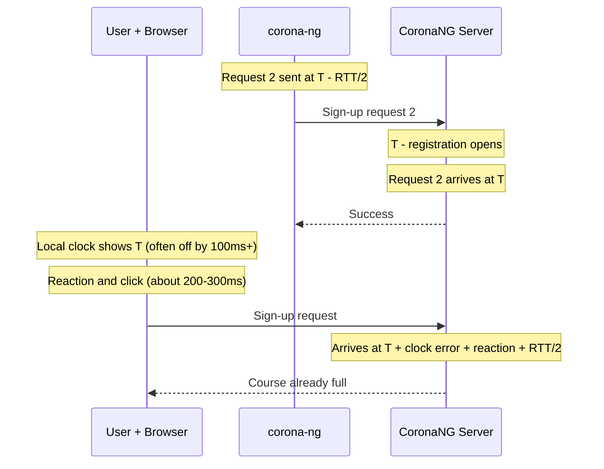
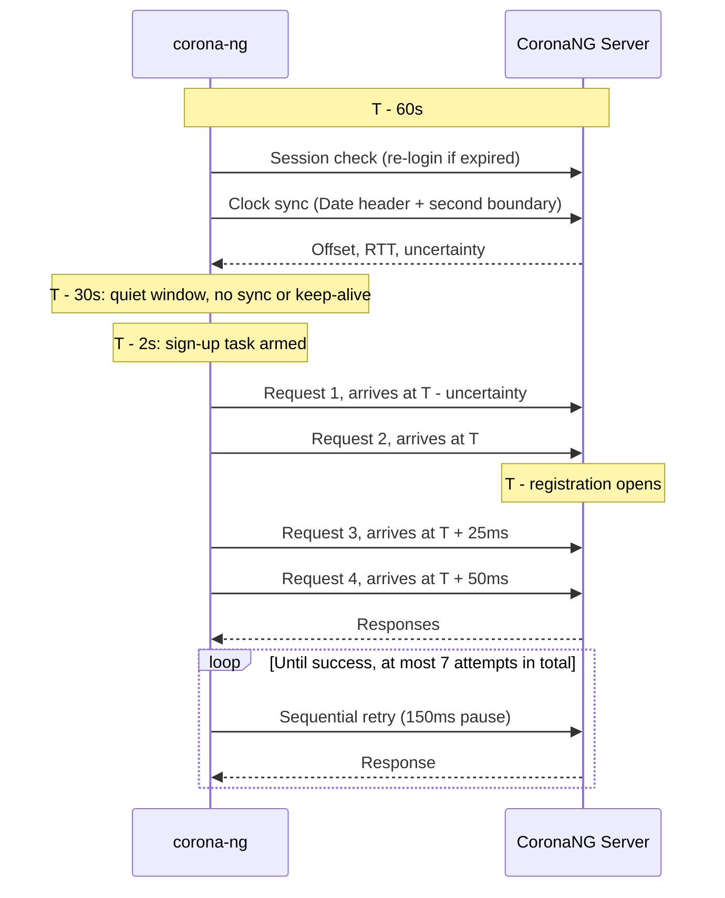

# CoronaNG - Automated ASQ Registration

`corona-ng` is a Terminal User Interface (TUI) designed to help students at the **University of Ulm** secure spots in **ASQ (Additive Schlüssel Qualifikationen)** courses via the [CoronaNG portal](https://campusonline.uni-ulm.de/CoronaNG/index.html).

## The Problem
Registration for ASQ courses typically opens at a specific time. Due to the high number of students trying to register simultaneously, the university servers often become overloaded, making it nearly impossible to get through using a standard web browser. When slots are limited, every millisecond counts.

## The Solution
This application is built with **Rust** and operates **headless** (without a browser). By bypassing the overhead of a browser engine and sending HTTP requests directly to the portal, it provides a significant speed advantage over manual registration.

### Key Features
- **Headless & High Performance:** Much faster than any browser-based approach.
- **Server Clock Sync:** Measures the offset between your system clock and the CoronaNG server clock, so the target time refers to the server, not to your machine.
- **Arrival-Based Timing:** Each request is sent half a round-trip time early, so it *arrives* at the server at its planned time.
- **Staggered Burst:** 4 parallel requests arrive around the target (one early by the clock uncertainty, then at `+0ms`, `+25ms` and `+50ms`). This covers clock errors in both directions without flooding the server.
- **Automatic Retries:** If the burst does not succeed, sequential retries follow with a 150ms pause, up to 7 attempts in total.
- **Robust Session Handling:** Keeps the session alive, checks it shortly before each target and logs in again automatically when it expired.
- **Modern TUI:** Built with `ratatui`, providing a dashboard to view observed courses.
- **Secure Credential Storage:** Uses the system keyring to securely store your university credentials.
- **Real-time Feedback:** Shows the live time, the server offset with its uncertainty, and the planned, sent, arrival and response time of every registration attempt.

## Why It Is Faster

Registration on CoronaNG opens by the **server clock**. A user in the browser
watches their own clock, waits for it to show the target time, clicks, and the
browser then sends the request and renders the response. Every step adds delay:

- The local clock is often off by hundreds of milliseconds or more.
- The human reaction and click take a few hundred milliseconds.
- The request needs half a round-trip time (RTT) to reach the server.
- The browser loads and renders full pages, while the server is under load.

`corona-ng` removes these delays:

- It measures the server clock offset and plans every request in server time.
- It sends each request `RTT/2` before its planned arrival.
- It is already logged in. The session is checked 60s before the target, so no
  login is needed at the target itself.
- It sends plain HTTP requests without a browser.
- From 30s before the target, it starts no clock syncs or keep-alives, so no
  other traffic competes with the sign-up requests.

### Browser vs. corona-ng



### Timeline of a Scheduled Sign-Up



### Clock Sync

The server clock is synced after login, every 10 minutes and 60s before each
target. A sync works in two steps:

1. **Coarse estimate:** 8 requests read the server time from the HTTP `Date`
   header (or from the "Serverzeit" on the course page). The fastest half is
   kept and the median offset is used.
2. **Second boundary:** The `Date` header has only whole-second resolution.
   `corona-ng` therefore polls the server just before the next second starts and
   detects the moment the server second changes. This is done 3 times and gives
   an offset that is accurate to a few tens of milliseconds.

The dashboard shows your system time (in German time) with the measured offset (e.g.
`16:00:00.000 +0.120s`) and below it the uncertainty (e.g.
`Server-Offset +/-15ms`). A positive offset means the server is ahead of your
system clock. If the offset is larger than 1s, a warning is shown. Your sign-up
still works in that case, but you should check your system time sync.

The sign-up popup shows four times for every request, all relative to the
target: `Planned` (planned send time), `Sent`, `Arrival` (estimated as
`Sent + RTT/2`) and `Response`.

## Success Story
This tool was successfully used to secure a spot in a course with **180 observers** and only **20 available places**. While the website was unreachable for many, `corona-ng` successfully pushed through the registration in the first few milliseconds.

## Technical Stack
- **Language:** Rust
- **Async Runtime:** `tokio`
- **Time:** `chrono` & `chrono-tz`
- **Networking:** `reqwest` (with cookie management)
- **UI:** `ratatui` & `crossterm`
- **Security:** `keyring` (OS-native credential storage)
- **HTML Parsing:** `scraper`

## Setup & Usage

### Prerequisites
- [Rust](https://rustup.rs/) installed
- Access to a kiz account

### Building from Source
```bash
cargo build --release
```

### Running
```bash
cargo run --release
```

### How to use in practice

1. **Observe courses:** Visit [the CoronaNG portal](https://campusonline.uni-ulm.de/CoronaNG/index.html) and click "observe" on your desired courses.
2. **TUI Login:** Enter your kiz credentials into the TUI.
3. **Browse:** View the list of observed courses and their current status.
4. **Schedule:** Select a course and set the registration time (e.g., `16:00`). Times are always interpreted in German time (Europe/Berlin), independent of the time zone of your machine.
5. **Deploy:** Keep the app running; it will automatically trigger the registration burst at the scheduled time and retry if needed. A popup will open shortly before the timer ends and shows the result of every request.

> **Important:** CoronaNG allows only one session per user. Signing in to the
web-portal ends the session of the TUI, and a login by the TUI ends the session
in the browser. The TUI logs in again automatically when its session expired,
and checks its session about 60s before each scheduled target. If you sign in
on the website shortly before the target, the TUI has to log in again at the
target itself, which costs time. Do not use the website in the last minute
before a scheduled target.

## Disclaimer
This tool is for personal use and intended to assist in course registration. Please use it responsibly and in accordance with the university's IT policies.

## License
[MIT](/LICENSE), also see [licenses of dependencies](/DEPENDENCIES.md).
